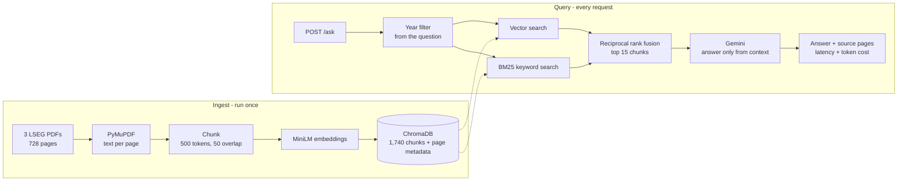

# LSEG RAG Assistant

A question-answering API over three LSEG annual reports (2023, 2024, 2025). Ask a question in plain English and get an answer grounded in the reports, with the source file and page numbers. If the answer is not in the documents, it says so instead of guessing.

**Stack:** Python, PyMuPDF, sentence-transformers, ChromaDB, BM25, Gemini API, FastAPI, Docker, AWS EC2, GitHub Actions.

**Live demo:** `http://<EC2_PUBLIC_IP>:8000/docs` (runs only while the EC2 instance is up; I stop it to avoid AWS costs).

> Screenshot: add `docs/screenshot-docs.png` here.
> Demo GIF: add `docs/demo.gif` here.

---

## How it works



1. **Ingest:** each PDF page is extracted with PyMuPDF and split into about 500-token chunks with a 50-token overlap. Chunks are made per page, so every chunk keeps an exact `source` and `page`. Chunks are embedded with `all-MiniLM-L6-v2` and stored in Chroma.
2. **Retrieve:** the question is searched two ways, by meaning (vector) and by exact words (BM25). The two rankings are merged with reciprocal rank fusion. If the question names a year, only that year's report is searched.
3. **Answer:** the top 15 chunks and the question go to Gemini with an instruction to use only the context and reply "I don't know based on the provided documents." if the answer is missing.
4. **Respond:** the API returns the answer, the source pages, latency, token counts and an estimated cost. Every request is also appended to `logs/requests.jsonl`.

## API

| Endpoint | Method | Purpose |
|---|---|---|
| `/health` | GET | Liveness check, returns `{"status": "ok"}` |
| `/ask` | POST | Body: `{"question": "..."}` |

Example response:

```json
{
  "answer": "£8,986 million",
  "sources": [{"source": "lseg_2025.pdf", "page": 30}],
  "latency_s": 1.5,
  "input_tokens": 7600,
  "output_tokens": 8,
  "est_cost_usd": 0.0023
}
```

---

## Evaluation

20 test questions with answers I checked by hand against the PDFs: 13 single-figure facts, 3 multi-year growth questions, 1 statutory revenue question and 3 questions the reports cannot answer (the system should refuse). A question passes if the answer contains an expected string. Run it with:

```bash
python eval/run_eval.py http://127.0.0.1:8000
```

### Results by version

| Version | Accuracy | Median latency | p95 latency | Avg input tokens | Avg est. cost / request |
|---|---|---|---|---|---|
| 1. Baseline: vector search, year filter, top 8 | 70% (14/20) | 0.95 s | 1.66 s | 3,821 | $0.00118 |
| 2. + BM25 hybrid search (RRF), top 8 | 85% (17/20) | 1.54 s | 2.31 s | 4,068 | $0.00124 |
| 3. + top 15, question 12 reworded | 95% (19/20) | 1.69 s | 2.33 s | 7,620 | $0.00230 |
| 4. + exact-figure prompt line | 100% (20/20) | 1.48 s | 2.22 s | 7,657 | $0.00232 |

Versions 1 to 4 were measured locally. Cost is **estimated at paid-tier Gemini prices** (the free tier means the real bill is $0).

### Deployed on EC2

Measured from my laptop against the EC2 instance, so latency includes network time.

| Metric | Value |
|---|---|
| Accuracy | `<fill in>` |
| Median latency | `<fill in>` |
| p95 latency | `<fill in>` |
| Avg input tokens | `<fill in>` |
| Avg est. cost / request | `<fill in>` |

### What failed and how I fixed it

| Problem | Cause | Fix |
|---|---|---|
| Table figures (total income 2024 and 2025) came back as "I don't know" | Vector search ranks narrative paragraphs above pages full of numbers | Added BM25 keyword search and merged both rankings. Accuracy 70% to 85% |
| 2025 total income and ETF AUM still missed | The right chunk was ranked 11th and 14th, outside the top 8 | Raised top-k from 8 to 15 (diagnosed by checking where the answer string ranked at k = 8, 15 and 30). Cost per request roughly doubled |
| "Statutory IFRS revenue" never found | The report never uses that phrase. The correct page ranked 149th in BM25 | Reworded the question to the report's own wording ("consolidated income statement"). Documented as a limitation |
| Answered "£9.0 billion" instead of £8,986 million | The model quoted a rounded figure from the Chair's narrative | Added one prompt line to prefer exact table values |

### Limitations

- **The 20 questions were also used for tuning**, so 100% is an upper bound, not a true generalisation score.
- **Retrieval is sensitive to wording.** The "statutory IFRS revenue" example shows a correct page ranked far down because the question used different words than the document. Query rewriting would be the next improvement.
- **Raising top-k trades cost for recall.** Going from 8 to 15 chunks recovered two questions but about doubled input tokens.
- **Only a year filter**, no company or section filter, because the corpus is a single company.
- **Single 1 GB instance**, no autoscaling, no HTTPS, no authentication. This is a demo, not a production service.
- **Cost figures are estimates** at paid-tier prices.

---

## Design choices

| Choice | Why |
|---|---|
| **Chroma over FAISS** | Easier to start with, persists to disk and stores metadata (page numbers) next to each vector |
| **Chunks per page, about 500 tokens, 50 overlap** | Keeps accurate page citations. 500 tokens is large enough to hold a table row with its heading, and overlap avoids splitting a sentence at a boundary |
| **`all-MiniLM-L6-v2` embeddings** | Free, runs locally, small enough for a 1 GB server. It is weak on number-heavy tables, which is why BM25 was added |
| **Hybrid search with reciprocal rank fusion** | Vector search finds meaning, BM25 finds exact terms like "Total income (excl. recoveries)". RRF merges them without tuning score weights |
| **Top-k = 15** | Chosen from the diagnostic: relevant chunks appeared at ranks 11 and 14 |
| **Gemini Flash** | Free tier, fast, and good enough for grounded Q&A. The model name is an environment variable, so it can be swapped without code changes |
| **Retry loop and request timeout** | The Gemini API returned 503 "high demand" errors during development |
| **Index on a volume, not in the image** | The index is data, not code. It is built once on the server and survives redeploys. PDFs never go through GitHub |
| **Build on the server in CI** | Keeps the pipeline simple and free (no registry). For production I would build in CI and push to ECR |

---

## Run locally

```bash
git clone https://github.com/mohammed123-code/lseg-rag-assistant.git
cd lseg-rag-assistant
python -m venv venv
venv\Scripts\activate          # macOS/Linux: source venv/bin/activate
pip install -r requirements.txt
cp .env.example .env           # then add your GEMINI_API_KEY
```

Put the three PDFs in `data/` as `lseg_2023.pdf`, `lseg_2024.pdf` and `lseg_2025.pdf` (they are not in the repo). Then:

```bash
python app/ingest.py                         # builds chroma_db/ (about 1 minute)
uvicorn main:app --app-dir app --reload      # API at http://127.0.0.1:8000/docs
```

Environment variables (`.env`):

```
GEMINI_API_KEY=
GEMINI_MODEL=gemini-3.8-flash
PRICE_IN_PER_M=0.30
PRICE_OUT_PER_M=2.50
```

The price values are used only for the cost estimate. Check Google's current pricing.

## Run with Docker

```bash
docker build -t lseg-rag .
docker run --rm -p 8000:8000 --env-file .env \
  -v "$PWD/chroma_db:/code/chroma_db" lseg-rag
```

The API key is passed at run time and is never baked into the image.

## Deployment (AWS EC2 and GitHub Actions)

- **Server:** Ubuntu 24.04 on a free-tier EC2 instance with Docker and a 2 GB swap file. The PDFs and index live in `~/app-data/` on the server.
- **First-time index build** (once, on the server):
  ```bash
  docker run --rm -v ~/app-data/data:/code/data -v ~/app-data/chroma_db:/code/chroma_db \
    lseg-rag python app/ingest.py
  ```
- **CI/CD:** `.github/workflows/deploy.yml` runs on every push to `main`. It connects to the server over SSH, pulls the code, rebuilds the image and restarts the container.
- **GitHub secrets needed:** `EC2_HOST`, `EC2_USER`, `EC2_SSH_KEY`.
- **Cost control:** the instance is stopped when not in use. The public IP changes on restart, so `EC2_HOST` is updated before the next deploy.

## Project structure

```
app/
  ingest.py      PDF -> chunks -> embeddings -> Chroma
  retrieve.py    year filter + vector + BM25 + rank fusion
  llm.py         prompt, Gemini call, retries, token and cost tracking
  main.py        FastAPI: /ask and /health
eval/
  questions.json 20 questions with hand-checked answers
  run_eval.py    accuracy, latency and cost per request
  baseline/      results of the first version, kept for comparison
.github/workflows/deploy.yml
Dockerfile
requirements.txt
```

## Possible next steps

- Query rewriting to match the document's own wording
- A cross-encoder reranker on the top 30 candidates
- A stronger embedding model for number-heavy tables
- A held-out question set that is never used for tuning
- Build in CI and push to ECR, HTTPS and authentication
